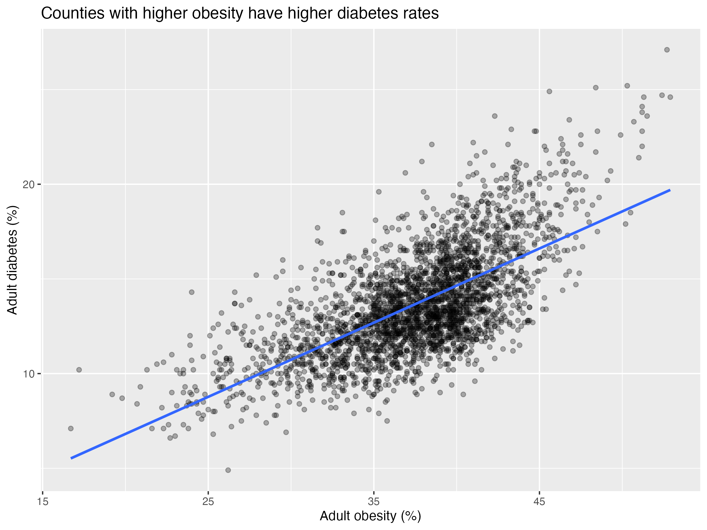

Here is my BIO 3100 Class:
[BIO3100](https://gzahn.github.io/data-course/) 


```{r setup, include=FALSE}
knitr::opts_chunk$set(echo = TRUE)
```

## About My Project

Diabetes and Stuff

```{r cars}
summary(cars)
```

## Including Plots

You can also embed plots, for example:

```{r pressure, echo=FALSE}
plot(pressure)
```


 


Note that the `echo = FALSE` parameter was added to the code chunk to prevent printing of the R code that generated the plot.
